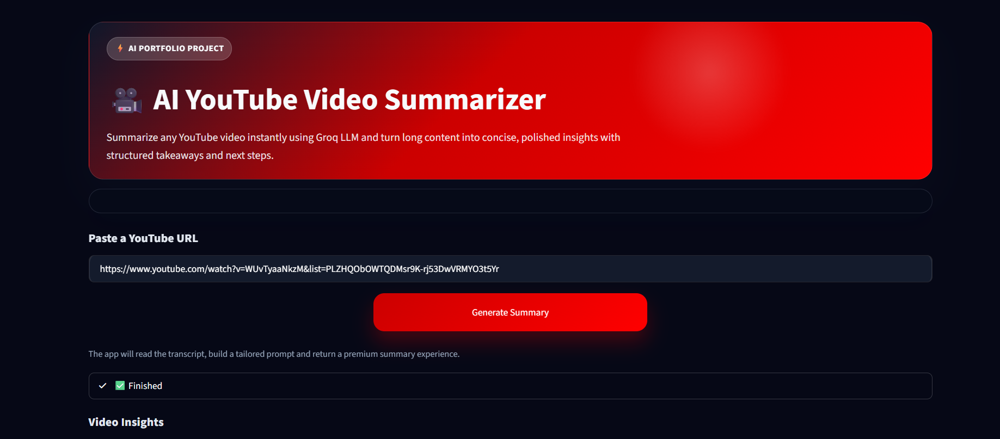
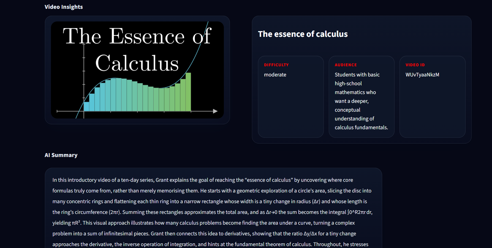

# 🎥 AI YouTube Video Summarizer

An AI-powered web application that converts YouTube videos into concise, structured summaries using **Groq LLM, Streamlit, and RapidAPI**.

🔗 **Live Demo:** https://youtube-video-summarizer-frontend.onrender.com

---

## ✨ Features

- 🎥 Summarize YouTube videos from a URL
- 🤖 AI-generated structured summaries
- 📝 Automatic transcript extraction (RapidAPI with `youtube-transcript-api` fallback)
- ⚡ In-memory 24-hour response caching (`st.cache_data`) to save API quota
- ⭐ Key points and takeaways
- 🏷️ Keywords
- 🎯 Target audience
- 📊 Difficulty level
- 🚀 Recommended next steps
- 📥 Download summaries as JSON or Markdown
- ☁️ Streamlined single-service deployment (no chained cold starts)

---

## 🛠️ Tech Stack

- **Frontend & App Framework:** Streamlit
- **AI:** Groq API (`openai/gpt-oss-120b`)
- **Transcript:** RapidAPI + YouTube Transcript API fallback
- **Video Metadata:** YouTube oEmbed / yt-dlp
- **Language:** Python

---

## 🖥️ Screenshots

### 🏠 Home Page

### 📊 Generated Summary

---

## 🔄 How It Works

~~~text
YouTube URL
     ↓
Streamlit Web App (ui.py)
     ↓
ai_backend.py (In-Process)
     ├── RapidAPI / youtube-transcript-api (Captions)
     ├── YouTube oEmbed / yt-dlp (Metadata)
     └── Groq LLM API (openai/gpt-oss-120b)
     ↓
Structured JSON & 24h In-Memory Cache (st.cache_data)
     ↓
Interactive Streamlit Dashboard
~~~

---

## 🚀 Run Locally

### 1. Clone the Repository

~~~bash
git clone https://github.com/prashant25gourav/youtube-video-summarizer.git
cd youtube-video-summarizer
~~~

### 2. Create Environment & Install Dependencies

**Windows:**

~~~bash
python -m venv .venv
.venv\Scripts\activate
pip install -r requirements.txt
~~~

**Linux / macOS:**

~~~bash
python3 -m venv .venv
source .venv/bin/activate
pip install -r requirements.txt
~~~

### 3. Configure Environment Variables

Create a `.env` file in the project root (or configure Streamlit secrets in `.streamlit/secrets.toml`):

~~~text
GROQ_API_KEY=your_groq_api_key
RAPIDAPI_KEY=your_rapidapi_key
RAPIDAPI_HOST=youtube-2-transcript.p.rapidapi.com
~~~

### 4. Start the Application

~~~bash
python -m streamlit run ui.py
~~~

Open your browser at:

~~~text
http://localhost:8501
~~~

---

## ☁️ Deployment

The application deploys as a single **Render Web Service** using the included `render.yaml` Blueprint or via the Render dashboard:

| Setting | Value |
|---|---|
| **Environment** | Python |
| **Plan** | Free |
| **Build Command** | `pip install -r requirements.txt` |
| **Start Command** | `streamlit run ui.py --server.port $PORT --server.address 0.0.0.0 --server.headless true` |

### Environment Variables on Render

Configure the following in the Render service dashboard:

- `GROQ_API_KEY`: Your Groq Cloud API key
- `RAPIDAPI_KEY`: Your RapidAPI key
- `RAPIDAPI_HOST`: `youtube-2-transcript.p.rapidapi.com`

---

## 📂 Project Structure

~~~text
youtube-video-summarizer/
│
├── ai_backend.py      # Core AI pipeline (transcript, Groq LLM, prompt loader)
├── ui.py              # Streamlit dashboard and UI state
├── prompt.md          # LLM system prompt and output JSON schema
├── render.yaml        # Render single web service blueprint
├── requirements.txt   # Python project dependencies
├── README.md          # Documentation
├── screenshots/       # Application screenshots
├── legacy/            # Archived legacy code
│   └── server.py      # Former FastAPI server (kept for reference)
└── .gitignore         # Git ignore rules
~~~

---

## 🔮 Future Improvements

- 🌍 Multi-language summaries
- 💬 Chat with YouTube videos
- 📄 PDF export
- 📚 Summary history
- 👤 User authentication
- 🗄️ Database integration

---

## 📄 License

Developed for educational purposes as part of the **Samsung Innovation Campus GenAI Program**.

